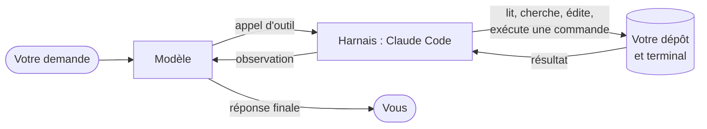

# Du chat à l'agent

*15 minutes, dont une démo.*

## Ce que fait un chat

Dans un chat, le modèle ne voit que ce que vous lui collez. Le cycle ressemble à ceci :

1. vous choisissez quels fichiers copier ;
2. le modèle propose du code ;
3. vous le collez, compilez, lancez les tests ;
4. vous recopiez l'erreur dans le chat ;
5. et vous recommencez.

Vous êtes la boucle. Le modèle travaille à l'aveugle : il ne sait pas si son code compile, ni ce que contiennent les autres fichiers.

## Ce qu'ajoute un agent

Un agent, c'est le même modèle placé dans une **boucle** avec des **outils**. Le modèle ne se contente plus de répondre : il peut demander à lire un fichier, chercher dans le code, lancer une commande. Le programme qui l'entoure (le *harnais*, ici Claude Code) exécute la demande et lui renvoie le résultat. Le modèle décide alors de la suite.



Le cœur tient en quelques lignes de pseudo-code :

```python
messages = [demande_utilisateur]
while True:
    reponse = modele(contexte=instructions + messages, outils=OUTILS)
    messages.append(reponse)
    if not reponse.appels_outils:
        break                       # le modèle estime avoir fini
    for appel in reponse.appels_outils:
        if autorise(appel):         # permissions : vous gardez la main
            resultat = executer(appel)
        else:
            resultat = "refusé par l'utilisateur"
        messages.append(resultat)   # le modèle observe et réagit
```

Vous construirez cette boucle vous-même en séance 3, avec l'API.

Trois conséquences :

- **Le modèle va chercher l'information** au lieu de deviner : il lit les fichiers, consulte `git log`, lance `--help`.
- **Il vérifie** : il compile, exécute les tests, lit l'erreur et corrige. C'est la meilleure parade aux hallucinations.
- **Il agit sur votre machine** : d'où les permissions, qui fixent ce qu'il peut faire sans vous demander.

!!! tip "À retenir"
    L'agent ne rend pas le modèle plus intelligent. Il lui donne accès au terrain et un moyen de vérifier son travail. La qualité du résultat dépend beaucoup de la qualité de ce moyen : des tests, un build, une commande pour reproduire le problème.

## Démo : la même tâche, deux façons

La tâche : dans le dépôt d'exercices, ajouter au calendrier une option **aller-retour**, où chaque rencontre est jouée deux fois en inversant domicile et extérieur.

**Version chat** (claude.ai)

1. Copier `calendrier.hpp` et `calendrier.cpp` dans le chat avec la demande.
2. Recopier la réponse dans les fichiers.
3. Compiler. Si cela échoue, recopier l'erreur dans le chat.
4. Se rendre compte que `main.cpp` et les tests n'ont pas été mis à jour, car le modèle ne les a jamais vus.

**Version agent** (Claude Code dans VS Code)

```text
Ajoute une option aller-retour au calendrier : chaque rencontre est jouée
une seconde fois, domicile et extérieur inversés, après la phase aller.
Fais-le en C++ et en PHP, avec des tests, et vérifie que make test passe.
```

Observez ce que fait l'agent sans qu'on le lui dise : il lit `CLAUDE.md`, explore les deux implémentations, trouve les tests existants, écrit le code et les tests, lance `make test`, corrige s'il le faut, puis résume ce qu'il a changé.

!!! warning "Piège"
    « Les tests passent » ne veut pas dire « le code est correct ». Si l'agent a écrit à la fois le code et les tests, il peut avoir fait la même erreur des deux côtés. Relire le diff reste votre travail.
