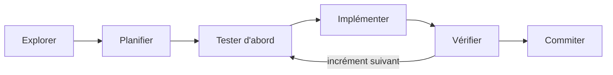

# Méthode de travail

*45 minutes.* Une boucle simple, qui s'applique à toute tâche non triviale :

Rien de neuf pour un développeur expérimenté. La différence, c'est que l'agent saute volontiers des étapes si on ne les lui impose pas.

## 1. Explorer avant de planifier

Demandez à l'agent de lire avant d'écrire : « Lis le code du classement et les tests associés, puis résume-moi comment ça marche. Ne modifie rien. »

Sur une tâche d'investigation lourde, demandez-lui de **déléguer à un sous-agent** : « Utilise un sous-agent pour trouver tous les endroits où les scores sont manipulés. » Le sous-agent travaille dans son propre contexte et ne renvoie qu'un résumé, ce qui préserve le vôtre.

## 2. Planifier avec le plan mode

En **plan mode**, l'agent lit, explore et propose un plan, mais ne modifie aucun fichier tant que vous ne l'avez pas approuvé.

- Dans VS Code : sélecteur de mode sous la zone de saisie, ou `/plan` suivi de la tâche.
- Dans le terminal : ++shift+tab++ jusqu'à « plan », ou `claude --permission-mode plan`.

Dans VS Code, le plan s'ouvre comme un document Markdown que vous pouvez annoter avant de l'accepter.

Ce qu'il faut vérifier dans un plan :

- Les fichiers touchés sont-ils ceux que vous attendiez ? Y en a-t-il trop ?
- Les cas limites sont-ils mentionnés ?
- Les tests sont-ils prévus, et **avant** le code ?
- L'agent a-t-il compris la même chose que vous ? C'est le moment le moins cher pour le découvrir.

!!! tip "Faire poser les questions"
    Pour une tâche floue, inversez les rôles : « Avant de proposer un plan, pose-moi les questions dont tu as besoin pour lever les ambiguïtés. » Les questions de l'agent révèlent souvent ce que vous n'aviez pas spécifié.

## 3. Spécifier avec des critères d'acceptation

Une demande efficace contient quatre éléments :

| Élément | Exemple |
|---|---|
| **Le but** | Générer le premier tour d'une phase finale à élimination directe |
| **Le contexte** | À partir du classement existant ; même comportement en C++ et en PHP |
| **Les contraintes** | Ne pas modifier le calcul du classement ; pas de nouvelle dépendance |
| **Les critères d'acceptation** | Avec 8 qualifiés : 1-8, 4-5, 2-7, 3-6 ; refus si le nombre n'est pas une puissance de 2 ; tous les tests passent |

Les critères d'acceptation doivent être **vérifiables par une machine** : un exemple d'entrée et de sortie, une commande qui doit réussir. « Le code doit être propre » n'en est pas un.

!!! warning "Piège"
    Sans critère vérifiable, l'agent s'arrête quand **il** estime avoir fini. Avec un critère vérifiable, il s'arrête quand le critère est rempli, et vous pouvez le constater.

## 4. Tester d'abord

Le TDD est particulièrement adapté au travail avec un agent :

1. « Écris les tests correspondant à ces critères. Ne touche pas au code de production. »
2. « Lance-les et montre-moi qu'ils échouent, et pour la bonne raison. »
3. Relisez les tests : ce sont **eux** la spécification.
4. « Écris le code minimal pour les faire passer. Ne modifie pas les tests. »

Séparer les deux étapes empêche l'agent d'écrire des tests taillés sur mesure pour son implémentation.

!!! warning "Piège"
    Un agent bloqué peut être tenté de « corriger » un test plutôt que le code. Dites-le explicitement : « Les tests sont la référence. Si l'un d'eux te semble faux, arrête-toi et explique pourquoi. »

## 5. Avancer par petits incréments

- **Un incrément = une demande = un commit.** Si un incrément part de travers, on revient au commit précédent.
- **Interrompez tôt.** ++esc++ arrête l'agent en cours de route ; vous pouvez alors réorienter : « Non, garde la signature actuelle. »
- **Revenez en arrière.** Claude Code prend des points de contrôle avant chaque modification. `/rewind` (ou ++esc++ ++esc++ dans le terminal, le bouton de retour en arrière au survol d'un message dans VS Code) restaure le code et/ou la conversation à un point antérieur. Git reste le filet de sécurité principal : les points de contrôle ne couvrent pas tout, notamment les effets des commandes shell.

## 6. Gérer le contexte

Rappel de la séance 1 : le contexte est la ressource à préserver.

| Commande | Effet | Quand l'utiliser |
|---|---|---|
| `/clear` | Repart d'un contexte vide | Entre deux tâches sans rapport. C'est le geste le plus sous-utilisé |
| `/compact [consigne]` | Remplace l'historique par un résumé, éventuellement orienté | Session longue sur une même tâche : `/compact garde les décisions sur l'API` |
| `/context` | Montre ce qui occupe le contexte | Quand les réponses se dégradent sans raison apparente |
| `claude --continue` | Reprend la dernière conversation du dossier | Retour après une pause |
| `claude --resume` | Choisit une conversation passée | Reprendre une tâche précise |

!!! tip "À retenir"
    Ce qui doit survivre à un `/clear` ou à un changement de poste doit être **écrit** : dans `CLAUDE.md` pour les règles durables, dans un fichier de notes ou un plan versionné pour l'état d'une tâche.

## Démo

Sur le dépôt d'exercices, en direct :

1. Plan mode : « Je veux départager les équipes à égalité de points par leur confrontation directe, avant la différence de buts. Pose-moi d'abord tes questions. »
2. Répondre aux questions (que faire à trois équipes à égalité ?), puis lire et annoter le plan.
3. Faire écrire les tests seuls, les voir échouer.
4. Interrompre l'implémentation avec ++esc++ pour imposer une contrainte, puis `/rewind` pour montrer le retour arrière.

## Pour aller plus loin

- [Bonnes pratiques Claude Code](https://code.claude.com/docs/en/best-practices)
- [Flux de travail courants](https://code.claude.com/docs/en/common-workflows)
- [Sessions et reprise](https://code.claude.com/docs/en/sessions)
